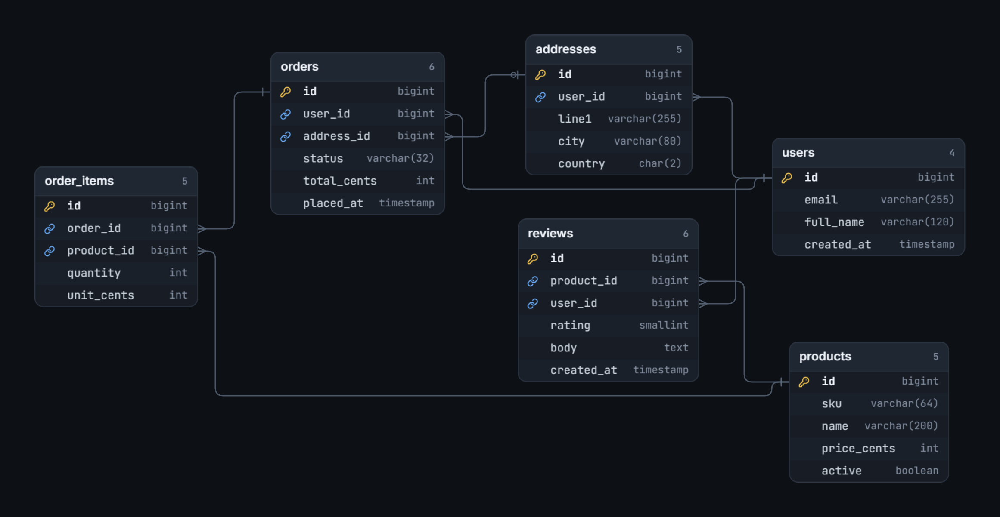
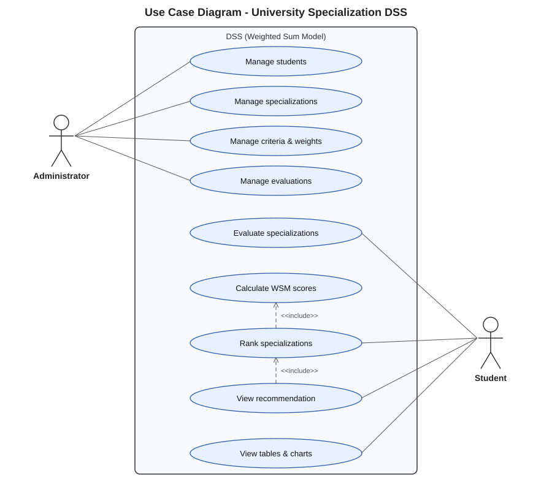

# 🎓 Decision Support System for University Specialization Selection

## 📌 Project Overview

The **Decision Support System (DSS) for University Specialization Selection** is a web-based application designed to help students choose the most suitable university specialization based on their academic performance, competencies, personal interests, and career opportunities.

The system uses a multi-criteria decision-making approach called the **Weighted Sum Model (WSM)** to evaluate, compare, and rank different university specializations.

The main goal is to provide students with an objective, data-driven recommendation that matches their individual profiles and preferences.

---

## 🎯 Project Objectives

- Manage student information.
- Manage university specializations.
- Define decision criteria and their respective weights.
- Evaluate specializations based on multiple criteria.
- Calculate an overall score for each specialization.
- Rank specializations according to their scores.
- Recommend the most suitable specialization.
- Present results through tables and visualizations.

---

## 🧠 Decision-Making Method

The project implements the **Weighted Sum Model (WSM)**.

This method calculates an overall score for each alternative by combining normalized evaluation values with their corresponding criteria weights.

### Available Specializations

The system considers four university specializations:

| ID | Specialization |
|---|---|
| P1 | Artificial Intelligence |
| P2 | Cybersecurity |
| P3 | Data Science |
| P4 | Information Systems and Software Engineering |

### Evaluation Criteria

Each specialization is evaluated using six criteria:

| Criterion | Type | Weight |
|---|---|---|
| Programming | Maximize | 0.20 |
| Mathematics | Maximize | 0.15 |
| Alignment with Student Competencies | Maximize | 0.20 |
| Career Opportunities | Maximize | 0.20 |
| Difficulty | Minimize | 0.10 |
| Personal Interest | Maximize | 0.15 |
| **Total** | | **1.00** |

Evaluation scores range from 1 to 10.

### Weighted Sum Model Formula

The overall score is calculated using:

**S(Pi) = Σ (Wj × Rij)**

Where:

- `S(Pi)` : Overall score of specialization Pi.
- `Wj` : Weight of criterion j.
- `Rij` : Normalized evaluation of specialization i according to criterion j.

The system normalizes evaluation values according to whether a criterion is maximized or minimized.

The specialization with the highest overall score receives the recommendation.

If two or more specializations obtain the same score, the system identifies the tie.

---

## ⚙️ Main Features

### 1. Data Management
- Add, edit, and delete students.
- Manage university specializations.
- Manage decision criteria and their weights.
- Manage specialization evaluations.

### 2. Evaluation System
- Evaluate specializations using predefined criteria.
- Normalize evaluation values.
- Calculate weighted scores using WSM.

### 3. Ranking System
- Display specializations in descending order.
- Compare their overall scores.
- Identify the highest-ranked specialization.

### 4. Recommendation System
- Analyze the calculated results.
- Recommend the specialization with the highest score.
- Identify ties when multiple specializations obtain the same score.

### 5. Data Visualization
- Display evaluation results.
- Present scores and rankings in organized tables and charts.

---

## 🛠️ Technologies

The project is based on the following technologies:

| Technology | Purpose |
|---|---|
| HTML5 | Application structure |
| CSS3 | Interface design and styling |
| JavaScript | Client-side functionality |
| PHP | Backend development |
| MySQL | Database management |

---

## 🗄️ Database

The application uses a relational database to store and manage:

- Students
- University specializations
- Decision criteria
- Criterion weights
- Evaluation scores

The database supports the storage, retrieval, and management of the information required by the decision support system.
---
## 🧩 Entity-Relationship Diagram (ERD)

---
## Relationships:

A student has many evaluations (one per specialization and criterion).
A specialization is evaluated on many criteria.
A criterion is used in many evaluations.
The RESULT table stores the final WSM score and rank of each specialization for each student.

## 🧱 UML Use Case Diagram:
UML Use Case Diagram



## 🚀 Installation and Setup

### Prerequisites

Make sure you have installed:

- [XAMPP](https://www.apachefriends.org/)
- [Visual Studio Code](https://code.visualstudio.com/)
- A modern web browser
- Git

### Step 1: Clone the Repository

```bash
git clone YOUR_REPOSITORY_URL
```

### Step 2: Move the Project

Place the project folder inside the XAMPP `htdocs` directory.

Example:
```text
C:\xampp\htdocs\DSS
```

### Step 3: Start XAMPP

Open XAMPP Control Panel and start:

- Apache
- MySQL

### Step 4: Configure the Database

1. Open phpMyAdmin.
2. Create the project database.
3. Import the provided SQL file (if available).
4. Configure the database connection in the PHP configuration file.

### Step 5: Run the Application

Open your browser and navigate to:

```text
http://localhost/DSS/
```

---

## 🎓 Academic Information

**University:** University of Guelma  
**Department:** Computer Science  
**Module:** Decision Support Systems (DSS)  
**Academic Year:** 2026–2027  
**Level:** Third Year – ISIL  
**Project:** Final Practical Project

---

## 👨‍💻 Authors

Developed as part of the Final Practical Project for the Decision Support Systems module by
-ishakbedahi@gmail.com
-bkbadri53@gmail.com
---

## 📄 License

This project was developed for academic and educational purposes.


[def]: schema.png
[def2]: schema.png